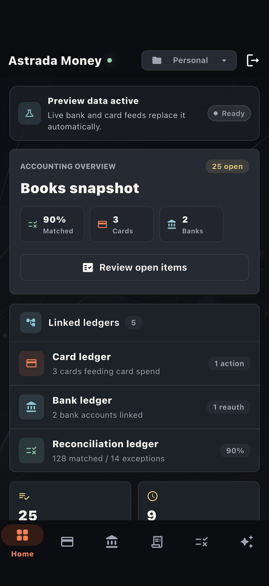

Hey, I’m Peter, a staff software engineer at [Astrada](https://astrada.co) in San Francisco.

## <picture><source media="(max-width: 600px)" srcset="assets/sections/work-mobile.svg"></picture>

###  Card enrollment and transaction data

Most of my work is on card enrollment and transaction data. At Astrada, I build the integrations that let an expense or accounting app use someone’s existing card and receive data about their purchases. I also work on bank linking through Plaid.

<picture>
  <source media="(max-width: 600px)" srcset="assets/work-map-mobile.svg">
  
</picture>

That work reaches from the enrollment UI down to network settlement feeds. The card integrations cover Visa, Mastercard, and Amex. I also build the self-service sandbox developers use to try the API.

###  Before Astrada

Previously, I was a Staff Software Engineer at Imprint and Marqeta.

The implementation lives in private repositories. Outside work, I build apps and experiment with local coding models.

## <picture><source media="(max-width: 600px)" srcset="assets/sections/projects-mobile.svg"></picture>

###  Tiles — daily logic puzzles

I also work on **[Tiles](https://cowbrickgames.com/tiles)** with Cowbrick Games. It’s a daily puzzle app with different rules on a shared drag-and-drop board. In Chicken Coop, you fill the board by solving equations; in Ghosts, you uncover ghosts by eliminating repeated numbers.

[See the games](https://cowbrickgames.com/tiles)

###  Local inference on a 12 GB GPU

I’m working on running models that are much larger than GPU memory, using [llama.cpp](https://github.com/ggml-org/llama.cpp) and [Strata](https://github.com/Niko1221/Strata).

#### The setup

My desktop has an **i9-14900K, 64 GB RAM, and an RTX 4070 SUPER with 12 GB VRAM**, with NVMe storage for weights that don’t fit in memory. Claude Code is the client for the coding worker.

#### Engine and cache work

The work goes into the inference engines as well as the harness around them. I’ve built a Rust cache-eviction library with a C interface for Strata’s RAM expert store, plus tools that compare intermediate model outputs layer by layer. I use saved runs to check whether a faster configuration also changes the answers.

#### Measured performance

Strata configurations on the same 30-question set · November 20, 2026

| Model / configuration | Generation | Correct |
| --- | ---: | ---: |
| Flash-Next 125B · IQ3_XXS | 53.2 tok/s | 22/30 |
| Flash-Next 125B · IQ3_XXS + MTP | 69.5 tok/s | 23/30 |
| Flash-Next 125B · IQ2_XS + MTP | 88.0 tok/s | 20/30 |
| DeepSeek-V4.1 · 2-bit, 5 of 6 experts | 15.9 tok/s | 26/30 |

30 questions: six each on code tracing, logic, math, counting, and step-by-step procedures. Scored on final answers.

MTP uses a draft model to propose multiple tokens per step. The MTP configurations above use a 32K context window. Scores are from my local hard-question set, with one completed attempt per question; they aren’t a general model ranking. Speeds are pooled generation rates, excluding prompt processing and tool execution.

Groot coding setup and cache experiments

#### Groot coding worker

My Groot-19B-A3B coding setup uses IQ4_XS weights and a custom llama.cpp build. An October 29 snapshot with 128K context, Q8 key/value cache and n-gram speculative decoding generated **103 tokens/s** across 181 requests. That log contains mixed chat and test traffic, so it is separate from the Strata comparison above.

#### Keeping experts in RAM

The newer cache work targets models that need to fetch experts from SSD. A recency-and-frequency eviction policy reduced simulated SSD miss bytes by **16–18% on a second, unseen trace** compared with LRU at a 37 GB cache budget. The Rust implementation matches the replay; that reduction is a trace-replay result, not a measured end-to-end speedup.

###  A personal finance app

A Flutter app built on Astrada for reviewing card and bank activity. It includes card-to-bank reconciliation and an assistant that answers questions using the account data. The app has a sample-data preview; the source is private.

###  A desktop companion for coding

**[ClaudeNavi](https://github.com/Topazoo/homebrew-claudenavi)** is inspired by MegaMan Battle Network. It reacts to your coding agent: a failed build can start a battle, and it remembers previous sessions. You can talk to it while you work.

The public repo has downloads and an explanation of how it works. Application source is private.

[Install](https://github.com/Topazoo/homebrew-claudenavi#install) · [Releases](https://github.com/Topazoo/homebrew-claudenavi/releases) · [How it works](https://github.com/Topazoo/homebrew-claudenavi#how-it-works)

## <picture><source media="(max-width: 600px)" srcset="assets/sections/tools-mobile.svg"></picture>

###  A starting point for a Flask app

**[Flongo Framework](https://github.com/Topazoo/Flongo-Framework)** puts request validation and MongoDB integration behind a common set of Flask routes. It also handles cookie-based JWT authentication. The README has a sample application you can work through.

It’s [published on PyPI](https://pypi.org/project/flongo-framework/). For a frontend too, [Flongo-Stack](https://github.com/Topazoo/Flongo-Stack) pairs the backend with a Flutter client.

[Sample app](https://github.com/Topazoo/Flongo-Framework#sample-app) · [Package](https://pypi.org/project/flongo-framework/)

###  Windows event collection

**[Windows Event Coverage](https://github.com/Topazoo/windows-event-coverage)** collects event metadata for offline analysis. When a channel can’t be read, it records the gap and keeps its checkpoint for a retry. An empty result shouldn’t look like proof that nothing happened.

The collector is PowerShell; the offline tools are Python. There are synthetic examples to try without supplying your own logs.

[Try the examples](https://github.com/Topazoo/windows-event-coverage#analyze-synthetic-examples-offline) · [Collector documentation](https://github.com/Topazoo/windows-event-coverage/blob/main/docs/COLLECTOR.md)

I also maintain [BiosBench Evidence](https://github.com/Topazoo/biosbench-evidence), which checks saved firmware reports and compares bytes against expected changes. It works offline and includes Rust examples for simulated save failures.

